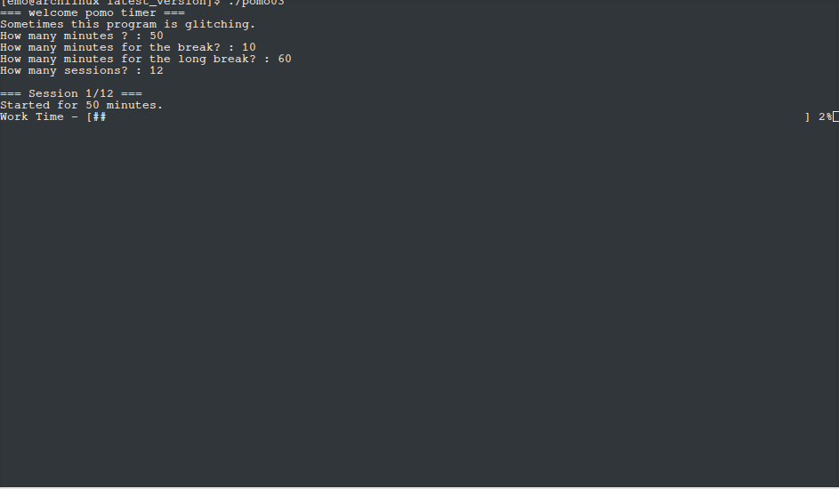

<div align="center">

☁️ ･ﾟ✧ ☁️ ･ﾟ✧ ☁️ ･ﾟ✧ ☁️ ･ﾟ✧ ☁️

# 🍓 ぽも · pomo 🍓

### ✨ ふわふわ ゆめかわ ASCII ポモドーロタイマー ✨

🦄 Linux 専用 ♡ 🍭 v2.1 が安定版 ♡ 🌈 C / Python / C++

☁️ ･ﾟ✧ ☁️ ･ﾟ✧ ☁️ ･ﾟ✧ ☁️ ･ﾟ✧ ☁️

</div>

---

## 🍰 うごいてるところ / Demo

<div align="center">



🌙 ターミナルでふわっと動いているようすです♡
*pomo running in a Linux terminal*

</div>

> 💡 画面を更新したいときは、`./main` を動かしたターミナルのスクリーンショットで `demo.png` を差し替えてね。

---

# 🇯🇵 にほんご

## 🌷 pomo ってなあに？
シンプルな **アスキーアートのポモドーロタイマー** だよ 🎀
C・Python・C++ で書かれています。

- 🌟 **v2.1** が今の安定版です
- 🕰️ `src/` 以下は過去の作品だけど、思い出として残してあります

## 🫧 v1.9 のおはなし
| ことば | いみ |
| --- | --- |
| 🍎 Work Time | 作業する時間 |
| 🍬 Short Break Time | ちいさなお休み |
| 🛁 Long Break Time | ながいお休み |
| 🔢 Sessions | トータルのセッション数 |
| 🎠 Long Interval spacing | 何回に一回、長休憩をとるか（ふつうは 4 だけど、今は 128 まで OK！） |
| 🔔 Reminder interval | 何分に一回、動画再生とメモ帳ポップアップをするか |

## 🍬 v1.8 のおはなし
v1.7 までは、ふつうのポモドーロと同じ動きだよ。
v1.8 からは **Additional Break Time** が仲間入り ✨
セッションの途中で、Work Time とは別に強制的に入れるお休みで、時間も自由に決められます。

## 🎀 うごく環境
- 🐧 Linux で使うことを想定しています
- 🧸 開発環境: Linux Mint 22.3 MATE

## 🛠️ コンパイルと実行
遊びたいバージョンのフォルダに移動して…

```bash
g++ main.cpp -o main
./main
```

## 🌸 これからやりたいこと
- 💨 もっと速くて軽いプログラムにする
- 🔄 Additional と Work Time だけを行き来してしまうところを直す

## ⚠️ おねがい
- 📁 ファイルやフォルダの構造は、できるだけ変えないでね
- 変えるときは自己責任で、パス・ソースコード・ファイル名を自分で直してください

## 📜 License
くわしくは `LISENCE` を見てね。

---

# 🇬🇧 English

## 🌷 What is pomo?
A simple, dreamy **ASCII art Pomodoro timer** 🎀
Written in C, Python and C++.

- 🌟 **v2.1** is the current stable version
- 🕰️ Files under `src/` are from earlier versions, kept as keepsakes

## 🫧 Behavior in v1.9
| Term | Meaning |
| --- | --- |
| 🍎 Work Time | Length of a work period |
| 🍬 Short Break Time | Length of a short break |
| 🛁 Long Break Time | Length of a long break |
| 🔢 Sessions | Total number of sessions |
| 🎠 Long Interval spacing | How often a long break is taken (standard Pomodoro uses 4; up to 128 is supported here) |
| 🔔 Reminder interval | How often (in minutes) a video plays and a Notepad window pops up |

## 🍬 Behavior in v1.8
Up to v1.7 the timer behaves like a standard Pomodoro.
**Additional Break Time** joined in v1.8 ✨ — a break you can forcibly start during a session, separate from Work Time, with a duration you choose.

## 🎀 System Requirements
- 🐧 Designed to run on Linux
- 🧸 Developed on Linux Mint 22.3 MATE

## 🛠️ Compile & Run
Go to the folder of the version you want, then:

```bash
g++ main.cpp -o main
./main
```

## 🌸 Planned Improvements
- 💨 Make it faster and more lightweight
- 🔄 Fix the issue where you can only toggle between Additional Break Time and Work Time

## ⚠️ Important Notes
- 📁 Please avoid changing the file and folder structure
- If you do, it's at your own risk, and you'll need to update paths, source code and filenames yourself

## 📜 License
See `LISENCE` for details.

<div align="center">

☁️ ･ﾟ✧ made with ♡ ✧･ﾟ ☁️

</div>
