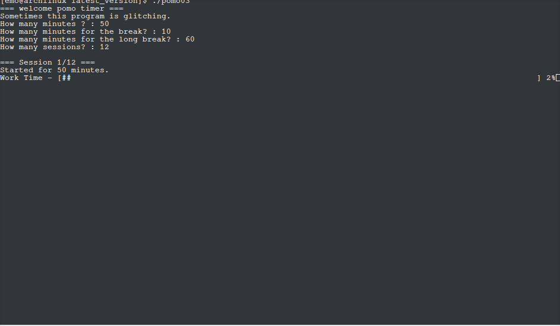

# pomo
A simple ascii style pomodoro work on cui written by C++ and etc.

## Overview
This Pomodoro app lets you check your progress using Sharp and [], and it can start playing a video at a scheduled time.
I created it because I was inspired by ASCII culture.

## Usage
- move to directory and run.
git clone https://github.com/eeemo-hoge/pomo

cd vx.x

g++ main.cpp

./a.out

## Features 
- ASCII art pomo
- Back and force to force break, force work system.
- notification system.

## Vision 
So far, this project I consider as a complete. 

## Images 

## License 
License is MIT.
